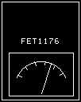

# FET1176



FET1176 is a clean-room, bass-focused FET compressor for the **ZOOM MS-60B+**.
It combines the fast, assertive gain control associated with classic 1176-style
compressors with bass-friendly parallel dry level and a detector high-pass
filter.

Version 0.22 has been built, installed, and tested on an MS-60B+ running
firmware 1.20. Audio processing, bypass, parameter editing, default values,
sidechain HPF smoothing, and the dark-panel display theme have all been checked
on hardware.

> [!CAUTION]
> Custom ZD2 effects are experimental. Incorrect installation or saving an
> unstable custom effect into a boot patch can make an MS Plus pedal unusable.
> Read [SAFETY.md](SAFETY.md) before building or installing anything.

## What it does

FET1176 uses a peak detector, program-dependent gain reduction, four ratio
curves, a soft knee, independent attack and release controls, and a detector
HPF. The `IN` control drives the detector threshold rather than simply boosting
the audio path, so increasing compression does not automatically create an
equivalent input-volume increase.

The dry control is deliberately **additive**, like a dedicated clean-level knob
on a bass compressor. It is not a wet/dry crossfade: raising `DRY` restores
attack and articulation and can also increase the final level.

## Controls

| Control | Range | Default | What it does |
|---|---:|---:|---|
| **IN** | 0–100 | **75** | Compression drive. Maps across a 0–60 dB detector-threshold range. Higher values produce more gain reduction while the audio input itself remains compensated. Reduce this for hotter active basses. |
| **OUT** | 0–100 | **55** | Make-up gain from −30 to +30 dB. `50` is 0 dB/unity. Use it to match the engaged and bypassed loudness. |
| **DRY** | 0–100 | **30** | Adds the uncompressed signal in parallel. `0` is compressed signal only; `100` adds dry signal at unity. This is a clean-level control, not a crossfade. |
| **RATIO** | 4:1, 8:1, 12:1, 20:1 | **4:1** | Sets the strength of compression above the knee. 4:1 is the most natural; 20:1 approaches limiting. |
| **ATACK** | 0–100 | **70** | Attack time from approximately 2 to 80 ms, fast to slow. Lower values restrain the initial transient; higher values preserve more finger, pick, and slap impact. The abbreviated spelling fits the pedal UI. |
| **RELSE** | 0–100 | **25** | Release time from approximately 50 ms to 1.1 s, fast to slow. Shorter release sounds more lively; longer release is smoother and can remain compressed between notes. |
| **HPF** | 0–100 | **10** | Detector-only high-pass filter from 20 to 500 Hz. Higher values stop deep bass energy from dominating the detector, allowing low notes to retain more weight. It does not remove bass from the audible signal. |

## Default sound

The add-effect defaults are:

```text
IN 75 · OUT 55 · DRY 30 · 4:1 · ATACK 70 · RELSE 25 · HPF 10
```

This starting point was calibrated with a passive Jazz Bass. It kept slap and
pluck peaks roughly 10 dB below bypass while retaining articulation and similar
perceived loudness. The algorithm is not specific to passive instruments;
active or unusually hot basses may simply need a lower `IN` setting.

## Compatibility

- Hardware validated: **ZOOM MS-60B+**, firmware **1.20**
- Target mask: `0x00A0`
- Effect category: Dynamics
- Declared DSP load: 30 raw units (11.1% of the MS Plus 270-unit budget)
- Seven parameters across two edit pages

Other MS Plus models and firmware versions have not been hardware validated.

## Repository status and downloads

The public identity is filename `MBF1176`, display name `FET1176`, and effect
ID `0x01004000`. The top byte (`0x01`) places the effect in the MS-60B+
Dynamics category. The author coordinate (`low16 0x4000`) is the first value
in the project's self-reserved `MB` block, `0x4000–0x43FF`.

See [RELEASING.md](docs/RELEASING.md) for the identity rationale and collision
policy. Always compare a download's checksum with the release notes before
installing it.

### Version 0.22 files

- [`MBF1176.ZD2`](dist/MBF1176.ZD2) — effect container
- [`MBF1176.ZIC`](dist/MBF1176.ZIC) — matching browser icon

SHA-256:

```text
90DBC1EB286146142DC7D26F2BB22349530C7808C6F81907EAA3864EC2EFCC58  MBF1176.ZD2
A8AB84BA5C38B10AFCDC3A90A8CF3C548087DE7C7BA2A26D737F487EE665027A  MBF1176.ZIC
```

The DSP and icon are the same hardware-tested 0.22 implementation; this public
artifact differs in its permanent ID, filename, and badge. The complete clean
build validation is in
[BUILD-REPORT-0.22-PERMANENT.md](docs/BUILD-REPORT-0.22-PERMANENT.md).

## Building for your own pedal

FET1176 is built with the clean-room toolchain from
[stomphacks](https://github.com/thammer/stomphacks).

1. Clone `stomphacks` and install its documented Python and TI C6000 build
   dependencies.
2. Copy the files from `source/` into `stomphacks/effects/fet1176/`.
3. Add the `matheusbrasil` / `MB` / `0x4000–0x43FF` author row described in
   [RELEASING.md](docs/RELEASING.md) to your local
   `ids/effect-authors.json`. This is required because the toolchain validates
   author namespaces.
4. From the `stomphacks` root, build with:

   ```text
   .venv/Scripts/python.exe tools/zd2_make_effect.py effects/fet1176/manifest.json
   ```

5. Confirm every line of the generated `REPORT.md` passes.
6. Follow [SAFETY.md](SAFETY.md) exactly before connecting a pedal.

The hardware-validated development build report is preserved at
[docs/BUILD-REPORT-0.22.md](docs/BUILD-REPORT-0.22.md).

## Clean-room provenance

The DSP kernel is an original implementation based on measured behavior and
publicly described control semantics. The repository contains no ZOOM firmware,
stock effect files, stock artwork, plug-in binary, decompiled third-party code,
or copied DSP implementation. The ZD2 container and monochrome icon are
synthesized from scratch by the build system.

Technical details are in [docs/TECHNICAL.md](docs/TECHNICAL.md).

## License and trademarks

FET1176 source and original artwork are released under the MIT License. See
[LICENSE](LICENSE).

ZOOM and MS-60B+ are trademarks of their respective owner. 1176, UREI,
Universal Audio, FETish, Analog Obsession, Cali76, and Origin Effects are names
or trademarks of their respective owners. This independent project is not
affiliated with or endorsed by any of them.

## Acknowledgements

- [stomphacks](https://github.com/thammer/stomphacks) — clean-room MS Plus
  effect build system and safety tooling
- [zoom-zt2](https://github.com/mungewell/zoom-zt2) — ZD2/ZIC format and pedal
  communication research
- [REA](https://github.com/morluto/rea) — evidence-oriented reverse-engineering
  tooling used during behavioral analysis

